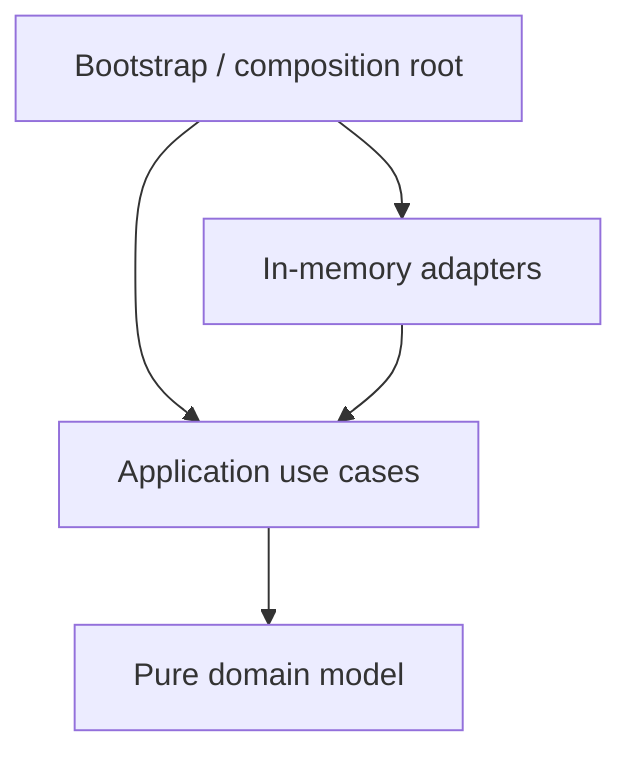
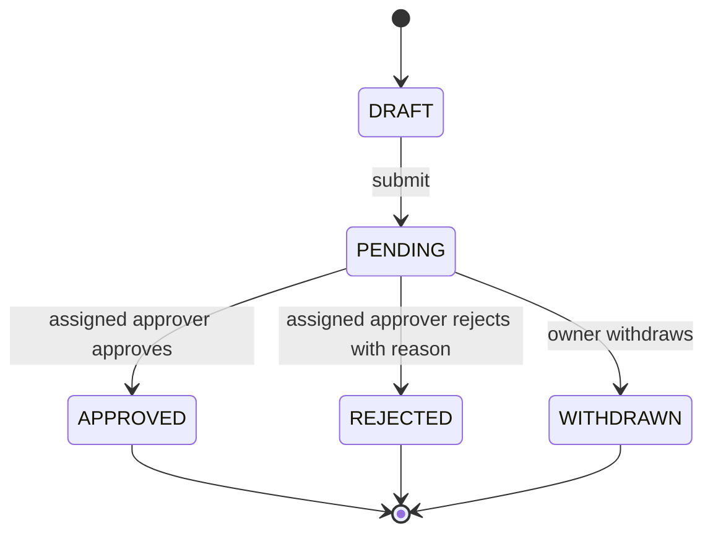

# Java 17 Expense Approval Workflow

A framework-free Maven multi-module example of DDD and Hexagonal Architecture. Java 17 is required; Maven 3.9+ is recommended.

## Architecture



The dependency direction is toward domain concepts: `approval-domain` has no runtime dependencies; application owns ports; adapters implement those ports; bootstrap wires the graph.



## Modules

- `approval-domain`: aggregate, value objects, events, invariant exceptions; independently testable.
- `approval-application`: commands, workflow use case, repository/clock/publisher/notification ports.
- `approval-adapters`: defensive-copy in-memory repository, fixed clock, recording publisher and notification adapter.
- `approval-bootstrap`: runnable composition root.
- `approval-architecture-tests`: ArchUnit dependency rules.

## Rules and design

Amounts must be positive, use a known ISO currency, and have no fractional precision beyond the currency's default. Owners cannot be their own approver. Only the assigned approver can approve/reject pending requests; only the owner can withdraw. Rejection needs a nonblank reason. Terminal states cannot transition. Each successful transition increments version and appends an immutable event. Failed domain operations validate before mutation and do not append events.

The aggregate stores immutable event history; application captures the newly appended suffix after a command. Event IDs are random UUIDs and occurrence timestamps come from the application-owned `ClockPort`. The in-memory repository is synchronized and checks optimistic versions, returning defensive copies. Duplicate creates and repeated transitions fail rather than silently succeeding. No command idempotency-key ledger is implemented, so retries after a successful command return a state-transition failure.

Persistence is committed before publication and notifications. Therefore a publisher/notification exception can occur after state is saved, and delivery is not atomic or exactly-once. Production should use a transactional outbox written in the same database transaction as aggregate state, then an idempotent dispatcher with retry/dead-letter policy. A real repository must implement compare-and-swap/version checks in the database transaction; the synchronized in-memory adapter does not model process crashes or distributed concurrency.

## Build and run

```bash
mvn clean verify
mvn -pl approval-bootstrap -am package
mvn -pl approval-bootstrap -am org.codehaus.mojo:exec-maven-plugin:3.3.0:java -Dexec.mainClass=com.example.approval.Main
```

The demonstration command uses the Maven Exec Plugin to run with the reactor dependency classpath. The `mvn clean verify` command runs unit and architecture tests.

## Adding real adapters

Implement `ExpenseRequestRepository` using transactional persistence and enforce `WHERE id = ? AND version = ?` on updates. Add an outbox port/table and save events in the same transaction. Implement `ClockPort` with `Clock` in the composition root. Notification adapters should consume outbox entries idempotently; keep provider SDKs outside domain/application modules.

## Limitations and assumptions

No HTTP API, authentication, database, schema migration, durable outbox, or command idempotency ledger is included. The example treats `Currency.getDefaultFractionDigits()` as the monetary precision rule and uses descriptive strings for users. Application publishes and notifies sequentially after persistence; delivery failures are surfaced to callers but do not roll back the saved request. Creation itself emits no domain event because the requested event list only specified transition events.
